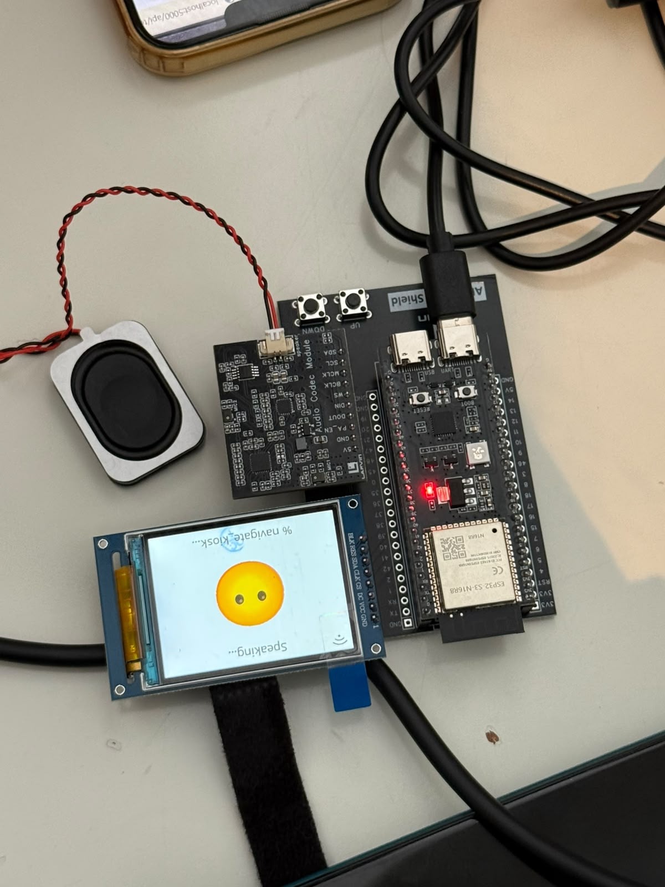

# 🤖 ESP32-S3 AI Voice Assistant

A pocket-sized, voice-controlled AI assistant built on the **ESP32-S3**. You speak to it, it streams your voice to a large language model over Wi-Fi, and it answers out loud through its speaker while showing the conversation on a 2.0" color screen.

> Built by Invictus for Yunex 2026

---

## 📸 Photo


---

## ✨ Features

- 🎙️ **Voice input** with dual omnidirectional microphones
- 🧠 **AI conversation** through a cloud LLM API (streamed responses)
- 🔊 **Spoken replies** through an onboard speaker
- 🖥️ **2.0" IPS display** that shows status, transcribed text and the AI's answers
- 🔘 **Physical buttons** to scroll through long answers
- 📶 **Wi-Fi + BLE 5.0** (ESP32-S3)
- 🔌 Powered over **USB-C**


### Buttons
| Function | ESP32-S3 GPIO |
|---|---|
| Scroll up | **GPIO20** |
| Scroll down | **GPIO19** |


### Power
| Module | Voltage |
|---|---|
| ESP32-S3 | 5 V via USB-C (3.3 V logic) |
| Display, audio module | 3.3 V from the ESP32 board |


### Block diagram

```
            ┌──────────────────────────┐
  🎙️ Mics ──►│                          │
            │   Audio Codec (I2S+DSP)  │──► 🔊 Speaker
            └────────────┬─────────────┘
                         │ I2S
            ┌────────────▼─────────────┐   SPI   ┌──────────────┐
  🔘 BTN ───►│        ESP32-S3          │────────►│ 2.0" ST7789  │
  (19, 20)  │  Wi-Fi ▲   PSRAM / Flash │         │   Display    │
            └────────┼─────────────────┘         └──────────────┘
                     │ Wi-Fi (HTTPS / WebSocket)
                     ▼
            ┌──────────────────────────┐
            │  Cloud AI API (LLM +     │
            │  speech-to-text / TTS)   │
            └──────────────────────────┘
```

---

## ⚙️ How It Works

1. **Wake / press:** the user says the wake word or presses the button.
2. **Record:** the codec samples the microphones over **I2S** (16 kHz, 16-bit mono) into PSRAM.
3. **Send:** the ESP32-S3 streams the audio over Wi-Fi to the AI service.
4. **Think:** the cloud service turns speech into text, runs the LLM, and turns the reply into speech.
5. **Reply:** the ESP32 receives the audio, plays it through the codec and speaker, and draws the text on the display.
6. **Scroll:** buttons on GPIO19/20 scroll long answers.

### Key values / settings
| Parameter | Value | Why |
|---|---|---|
| CPU clock | 240 MHz | Enough headroom for audio + networking |
| Audio sample rate | 16 000 Hz | Standard rate for speech recognition |
| Bit depth | 16-bit, mono | Small payloads, good enough for voice |
| Audio codec (network) | Opus | Compresses voice to save bandwidth |
| Display | 240×320, SPI | Driven by the ST7789 controller |
| PSRAM | 8 MB | Buffers audio and screen frames |
| Wi-Fi | 2.4 GHz only | ESP32-S3 does not support 5 GHz |

---

## 🌐 API

> ⚠️ **TODO (team):** keep the option you actually used and delete the other.

**Option A: OpenAI**
- Endpoint: `https://api.openai.com/v1/...`
- Model: `gpt-4o` (or the model you used)
- Auth: `Authorization: Bearer <OPENAI_API_KEY>`

**Option B: DeepSeek**
- Endpoint: `https://api.deepseek.com/...`
- Auth: `Authorization: Bearer <DEEPSEEK_API_KEY>`

Put your keys in `secrets.h` (this file is in `.gitignore` and is **never committed**):

```cpp
#define WIFI_SSID     "your-wifi"
#define WIFI_PASSWORD "your-password"
#define API_KEY       "sk-..."
```


## 📚 Software & Libraries

| Library / tool | Version | Source | Used for |
|---|---|---|---|
| ESP-IDF / Arduino-ESP32 | `x.x` | https://github.com/espressif/esp-idf | ESP32-S3 framework |
| xiaozhi-esp32 | `x.x` | https://github.com/78/xiaozhi-esp32 (MIT) | Voice-assistant firmware base |
| LVGL | `x.x` | https://github.com/lvgl/lvgl | Display UI |
| ESP-SR | `x.x` | https://github.com/espressif/esp-sr | Wake word / audio front end |
| Opus | `x.x` | https://opus-codec.org | Voice compression |
| ArduinoJson *(if Arduino build)* | `x.x` | https://github.com/bblanchon/ArduinoJson | Parsing API responses |
| TFT_eSPI *(if Arduino build)* | `x.x` | https://github.com/Bodmer/TFT_eSPI | ST7789 driver |


## 🚀 Setup & Flashing

```bash
# 1. Clone
git clone https://github.com/<your-user>/<your-repo>.git
cd <your-repo>

# 2. Add your credentials
cp secrets.example.h secrets.h   # then edit it

# 3. Build & flash (ESP-IDF)
idf.py set-target esp32s3
idf.py build
idf.py -p <PORT> flash monitor
```

**Arduino IDE instead:** Board → *ESP32S3 Dev Module*, PSRAM → *OPI PSRAM*, Flash Size → *16MB*, Partition → *16M Flash (3MB APP)*, then Upload.

---

## 📁 Repository Structure

```
├── firmware/          # Source code
├── hardware/
│   ├── wiring.png     # Wiring diagram
│   └── BOM.csv        # Bill of materials
├── docs/images/       # Photos & screenshots
├── secrets.example.h  # Template for credentials
└── README.md
```

---

## 🛠️ Troubleshooting

| Problem | Fix |
|---|---|
| Upload fails | Hold **BOOT**, press **RST**, release BOOT, upload again |
| Screen is blank / white | Check SPI pins and the ST7789 setting in the config |
| No sound | Check the I2S pins and the speaker connector |
| Won't connect to Wi-Fi | Use a 2.4 GHz network |
| API error 401 | Wrong or expired API key |

---
